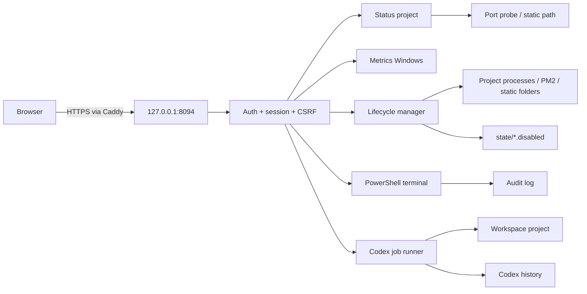
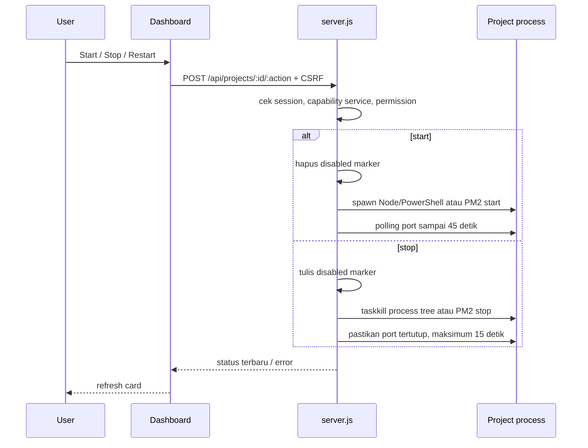

# Arsitektur dan Flow Sistem

## Ringkasan

`server.js` adalah satu-satunya backend. Ia memakai modul HTTP bawaan Node.js,
tanpa framework dan tanpa database. UI adalah static HTML/CSS/JavaScript di `public/`.
Konfigurasi user dan secret berada di `config.json`; status maintenance berada di
`state/`; log berada di `logs/`.

## Project registry

Registry ada di konstanta `projects` pada `server.js`. Jangan mengandalkan daftar ini
secara terpisah karena status, permission, lifecycle, dan pilihan project semuanya
berasal dari registry yang sama.

| ID | Nama | Domain | Mode | Port / target | Startup |
|---|---|---|---|---|---|
| `cloudtrade` | CloudTrade | `tradecloud.asia` | Node | `192.168.0.130:8090` | `src/server.js` |
| `remote-codex` | Remote Codex | `xcodex.ruangiman.my.id`, `sync.ruangiman.my.id` | PowerShell | `127.0.0.1:8091` | `scripts/start-remote-codex.ps1` |
| `fmt` | FMT Operations | `fmt.ruangiman.my.id` | Node | `192.168.0.130:4310` | `server.mjs` |
| `ruangiman` | RuangIman | `ruangiman.my.id`, `www.ruangiman.my.id` | Static | folder public | tidak menjalankan process |
| `music` | Ruang Music | `music.ruangiman.my.id` | Node | `127.0.0.1:8095` | `server.js` |
| `ruangdrive` | RuangDrive | `drive.ruangiman.my.id` | PM2 | `127.0.0.1:8092` | PM2 name `ruangdrive` |
| `server` | Server Dashboard | `server.ruangiman.my.id` | Protected | `127.0.0.1:8094` | service ini |

## Flow request umum

1. Browser memanggil `/api/session`; bila gagal, UI menampilkan login.
2. `/api/login` memverifikasi password dengan `scrypt`, lalu membuat session in-memory
   8 jam dan CSRF token. Cookie session `HttpOnly`, `Secure`, dan `SameSite=Strict`.
3. Endpoint terlindungi mengambil session dari cookie, memperpanjang expiry, lalu
   mengecek capability dan project permission.
4. Request mutasi wajib mengirim `x-csrf-token`.
5. Error dikembalikan sebagai JSON `{ error }`.

## Flow status dan lifecycle

Status non-static ditentukan dari koneksi TCP ke `host:port`; static ditentukan dari
keberadaan `staticPath`/folder. File `state/<id>.disabled` mengubah service menjadi
maintenance dan membuat `online=false` walaupun proses masih terdeteksi.

## Terminal dan Codex

Terminal menjalankan PowerShell dari folder project, batas command 4.000 karakter,
timeout 60 detik, output 1 MB. Hash command dicatat di audit, bukan isi command.

Codex dijalankan sebagai child process background. UI menerima job `202`, melakukan
polling `/api/codex-jobs/:id` tiap detik, dan Cancel memakai `taskkill /T /F` untuk
seluruh process tree. Job dan output disimpan ke `logs/codex-history/`; job yang masih
running saat restart ditandai `interrupted`.

`codex-project-write` memakai sandbox `workspace-write`. `codex-full-access` memakai
`--dangerously-bypass-approvals-and-sandbox`; capability ini hanya untuk administrator.

## Data, retensi, dan pengembangan

| Lokasi | Isi | Retensi |
|---|---|---|
| `config.json` | session secret, user hash, encrypted API accounts | permanen; backup aman |
| `state/*.disabled` | marker maintenance | sampai Start |
| `logs/server.log`, `logs/<project>.log` | output proses | operasional |
| `logs/audit.log` | aksi user | 24 jam |
| `logs/codex-history/*.json/.log` | metadata, prompt, output Codex | 24 jam |

Audit dan history dibersihkan setiap jam. Session hilang saat process dashboard restart.

Saat menambah fitur: perbarui registry bila perlu, validasi capability di backend,
perbarui [API.md](API.md) dan flow ini, lalu jalankan `npm run check` serta
`node scripts/smoke-test.js` setelah service hidup.
